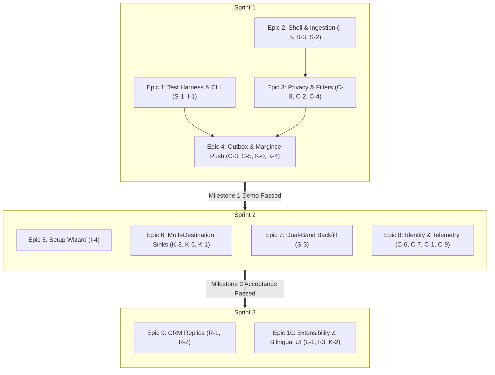

# Chat Bridge: Product User Story Catalog

**Document Version:** 1.2  
**Target Release:** Month 2 Beta (Demo: Fri 13 Nov 2026, Acceptance: Fri 27 Nov 2026)  
**Spec Reference:** [`docs/spec.md`](spec.md) (v0.5)  
**Architecture Decisions:** [`docs/decisions.md`](decisions.md) (ADRs 0001–0032)  
**Engineering Methodology:** [`docs/the-new-sdlc.md`](the-new-sdlc.md) (The Factory Model & Harness Engineering)  
**Foundation Scaffolding:** [`docs/factory-model-setup.md`](factory-model-setup.md) (Sprint 0 Setup Checklist)  
**Author:** Senior Product Manager

---

## Executive Summary & Product Personas

Chat Bridge connects personal WhatsApp and Zalo chats to Margince CRM, Google Sheets, and local analytical databases without exposing non-technical sales reps to command lines or configuration files.

### Key Personas

1. **Charlotte (Primary Persona: Non-Technical Sales Rep):**
   - _Profile:_ Uses her personal phone and laptop to chat with customers across Zalo and WhatsApp.
   - _Needs:_ Seamless CRM synchronization without manual copy-paste; zero technical friction (under 15-minute solo setup); absolute privacy guarantees that personal/family chats never leave her computer.
   - _Guardrail:_ Never encounters technical jargon (no words like _"sink"_, _"outbox"_, _"JID"_, _"daemon"_, or _"regex"_). Every error clearly explains what happened and states the exact next click to fix it.

2. **Marcus (Secondary Persona: Operations Lead & Technical Power User):**
   - _Profile:_ Manages team sales reporting, pipeline analytics, and destination integrations.
   - _Needs:_ Multi-destination fan-out (Google Sheets, local analytical SQLite database, custom webhooks, MCP server) where one failing destination never stalls or drops messages for others.
   - _Guardrail:_ Requires data freshness, schema stability, spreadsheet automation, and SQL access without degrading Charlotte's laptop performance.

3. **Dylan (Internal Persona: Software Engineer / Intern):**
   - _Profile:_ Engineering intern building and verifying Chat Bridge features through strict TDD.
   - _Needs:_ 100% CLI feature parity with `--json` outputs, scriptable headless execution, and deterministic simulation via a fake source and mock Margince server.
   - _Guardrail:_ Develops against fake fixtures and local mocks only; never handles real chat logins, passwords, or customer PII.

---

## Epic Hierarchy & Feature Traceability

### 1. High-Level Epic Architecture & Traceability

| Epic                                                    | Features                   | Scope  | Target Sprint | Milestone & Core Deliverable                                                                        |
| :------------------------------------------------------ | :------------------------- | :----- | :------------ | :-------------------------------------------------------------------------------------------------- |
| **Epic 1: Developer Testing Harness & Headless CLI**    | `S-1`, `I-1`               | Must   | Sprint 1      | Test fixture replay harness and headless developer CLI suite for Dylan.                             |
| **Epic 2: Desktop Shell & Core Chat Ingestion**         | `I-5`, `S-3`, `S-2`        | Must   | Sprint 1      | Zero-terminal desktop app shell and direct WhatsApp/Zalo QR code logins.                            |
| **Epic 3: Privacy Shield, Chat Picker & Noise Filters** | `C-8`, `C-2`, `C-4`        | Must   | Sprint 1      | Selective Chat Picker gating, sensitive pattern redaction, and protocol noise dropping.             |
| **Epic 4: Encrypted Outbox & Margince CRM Push**        | `C-3`, `C-5`, `K-0`, `K-4` | Must   | Sprint 1      | Encrypted SQLite WAL queue, rate pacing, and signed Margince CRM push delivery (Joint Live Demo).   |
| **Epic 5: Guided Setup Wizard & Usability Experience**  | `I-4`                      | Must   | Sprint 2      | 5-step guided onboarding wizard for Charlotte's solo 15-minute usability acceptance test.           |
| **Epic 6: Multi-Destination Analytics Sinks**           | `K-3`, `K-5`, `K-1`        | Must   | Sprint 2      | Independent parallel queues for Google Sheets, local SQLite database, and daily JSONL archives.     |
| **Epic 7: Dual-Band History Backfill**                  | `S-3`                      | Must   | Sprint 2      | Historical conversation backfill with user progress bar and background throttling.                  |
| **Epic 8: Identity Resolution & System Telemetry**      | `C-6`, `C-7`, `C-1`, `C-9` | Must   | Sprint 2      | WhatsApp LID-to-phone mapping, session expiry warnings, plain-language status, and resource guards. |
| **Epic 9: Human-in-the-Loop CRM Replies**               | `R-1`, `R-2`               | Should | Sprint 3      | Inbound CRM reply staging and one-click human-in-the-loop physical sending with failure acks.       |
| **Epic 10: Extensibility & Bilingual Interface**        | `L-1`, `I-3`, `K-2`        | Should | Sprint 3      | Full English/Vietnamese language toggle, local read-only MCP server, and generic webhook delivery.  |

---

### 2. Sprint Execution & Story Dependency Backlog

#### Sprint 1: Core Pipeline & Joint Live Demo (Target: Fri 13 Nov 2026)

_Goal: Prove end-to-end message flow from fake/real sources through encrypted outbox into Margince CRM and verify zero data leaks._

> [!NOTE]
> **Foundation / Factory Setup Prerequisite:**  
> Before implementing product features in Sprint 1, the monorepo workspace topology, AST guardrails, and contract test runners are initialized per the [Factory Model & Harness Engineering Setup Checklist](factory-model-setup.md).

| User Story ID  | Epic   | Feature | Title                                    | Priority | Immediate Dependencies                  |
| :------------- | :----- | :------ | :--------------------------------------- | :------- | :-------------------------------------- |
| **`US-S1-01`** | Epic 1 | `S-1`   | Fake Source & Mock Margince Harness      | Must     | **None** _(Foundational Testing Root)_  |
| **`US-I1-01`** | Epic 1 | `I-1`   | Developer & QA CLI Parity Suite          | Must     | `US-C3-01` _(Headless Core)_            |
| **`US-I5-01`** | Epic 2 | `I-5`   | Zero-Terminal Desktop App Shell          | Must     | **None** _(Foundational Desktop Shell)_ |
| **`US-S3-01`** | Epic 2 | `S-3`   | WhatsApp QR & Pairing Code Login         | Must     | `US-S1-01`                              |
| **`US-S2-01`** | Epic 2 | `S-2`   | Zalo QR Code Login & Session Guard       | Must     | `US-S1-01`                              |
| **`US-C8-01`** | Epic 3 | `C-8`   | Selective Authorization (Chat Picker)    | Must     | `US-S3-01` or `US-S2-01`                |
| **`US-C8-02`** | Epic 3 | `C-8`   | Live Activity Feed & Ad-Hoc Push         | Must     | `US-C8-01`, `US-C3-01`                  |
| **`US-C2-01`** | Epic 3 | `C-2`   | Sensitive Data, Contact & Group Filters  | Must     | `US-C8-01`                              |
| **`US-C4-01`** | Epic 3 | `C-4`   | Protocol Event & Noise Dropping          | Must     | `US-S1-01`                              |
| **`US-C3-01`** | Epic 4 | `C-3`   | Encrypted Local Outbox & SQLite WAL      | Must     | `US-S1-01`                              |
| **`US-C5-01`** | Epic 4 | `C-5`   | Rate Pacing, Backoff & Refusal Isolation | Must     | `US-C3-01`, `US-K4-01`                  |
| **`US-K0-01`** | Epic 4 | `K-0`   | Multi-Destination Fan-Out Pipeline       | Must     | `US-C3-01`                              |
| **`US-K4-01`** | Epic 4 | `K-4`   | Margince CRM Signed Push Delivery        | Must     | `US-S1-01`, `US-C3-01`                  |

#### Sprint 2: Full Polish, Secondary Sinks & Final Acceptance (Target: Fri 27 Nov 2026)

_Goal: Complete Charlotte's guided onboarding wizard, secondary fan-out destinations, backfill, and pass all Section 13 acceptance gates._

| User Story ID  | Epic   | Feature | Title                                       | Priority | Immediate Dependencies                                                 |
| :------------- | :----- | :------ | :------------------------------------------ | :------- | :--------------------------------------------------------------------- |
| **`US-I4-01`** | Epic 5 | `I-4`   | Guided 5-Step First-Run Setup Wizard        | Must     | `US-I5-01`, `US-S3-01`, `US-S2-01`, `US-C8-01`, `US-C2-01`, `US-K4-01` |
| **`US-K3-01`** | Epic 6 | `K-3`   | Google Sheets Real-Time Sync                | Must     | `US-K0-01`, `US-C3-01`                                                 |
| **`US-K5-01`** | Epic 6 | `K-5`   | Local Database Export (SQLite)              | Must     | `US-K0-01`, `US-C3-01`                                                 |
| **`US-K1-01`** | Epic 6 | `K-1`   | Daily Partitioned JSONL File Archive        | Must     | `US-K0-01`, `US-C3-01`                                                 |
| **`US-S3-03`** | Epic 7 | `S-3`   | WhatsApp History Backfill (Dual-Band)       | Must     | `US-S3-01`, `US-C8-01`, `US-C3-01`                                     |
| **`US-C6-01`** | Epic 8 | `C-6`   | Identity Resolution (WhatsApp LID to Phone) | Must     | `US-S3-01`                                                             |
| **`US-C7-01`** | Epic 8 | `C-7`   | Proactive Session Expiration Warnings       | Must     | `US-S3-01`, `US-S2-01`                                                 |
| **`US-C1-01`** | Epic 8 | `C-1`   | Real-Time Plain-Language System Status      | Must     | `US-C3-01`, `US-K0-01`                                                 |
| **`US-C9-01`** | Epic 8 | `C-9`   | Low-Overhead Resource & Health Telemetry    | Must     | `US-C3-01`                                                             |

#### Sprint 3: Post-Acceptance / "Should" Scope

_Goal: Deliver high-value extensions including inbound CRM replies, local desktop AI integrations, bilingual interface, and webhooks._

| User Story ID  | Epic    | Feature | Title                                   | Priority | Immediate Dependencies               |
| :------------- | :------ | :------ | :-------------------------------------- | :------- | :----------------------------------- |
| **`US-R1-01`** | Epic 9  | `R-1`   | Inbound CRM Reply Pulling & Staging     | Should   | `US-K4-01`                           |
| **`US-R2-01`** | Epic 9  | `R-2`   | One-Click Human-in-the-Loop Send & Ack  | Should   | `US-R1-01`, `US-S3-01` or `US-S2-01` |
| **`US-L1-01`** | Epic 10 | `L-1`   | Full English & Vietnamese Bilingual UI  | Should   | `US-I4-01`, `US-C8-01` _(Base UI)_   |
| **`US-I3-01`** | Epic 10 | `I-3`   | Read-Only Local MCP Server              | Should   | `US-K5-01` _(SQLite Replica)_        |
| **`US-K2-01`** | Epic 10 | `K-2`   | Generic Webhook Destination (SSRF Safe) | Should   | `US-K0-01`, `US-C3-01`               |

---

## Epic 1: Developer Testing Harness & Headless CLI (Sprint 1)

---

### US-S1-01: Deterministic Fake Source & Mock Margince Testing Harness

- **Feature ID:** `S-1` / `Section 8` | **Priority:** Must
- **User Persona:** Dylan (Software Engineer)
- **Dependencies:** None (Foundational Testing Root)
- **Status:** Complete
- **Technical Reference:** [Factory Model Setup: Phases 3 & 4](factory-model-setup.md#phase-3-synthetic-testing-harness--scenario-engine)
- **User Story:**
  > As a software engineer (Dylan) building Chat Bridge features,  
  > I want fully deterministic chat replay sources and offline protocol test doubles,  
  > So that I can execute rigorous Test-Driven Development (TDD) safely and repeatably without handling live accounts or customer credentials.
- **Acceptance Criteria:**
  - **Scenario 1: Fake Source replay**
    - **When** running `chat-bridge run --fake <fixture-file>`,
    - **Then** the engine replays predefined 1:1 messages, group messages, OTP codes, reactions, and 40,000-character oversized messages at a configured speed.
  - **Scenario 2: Mock Margince contract parity**
    - **Given** the Mock Margince server running locally,
    - **When** Chat Bridge pushes signed batches,
    - **Then** the mock validates HMAC signatures, checks nonces, enforces rate limits, and returns identical responses to Tam Vu's production Margince PR.

---

### US-I1-01: Developer & QA Command-Line Interface (CLI) Parity

- **Feature ID:** `I-1` | **Priority:** Must
- **User Persona:** Dylan (Software Engineer)
- **Dependencies:** `US-C3-01` (Headless Engine Core)
- **User Story:**
  > As a software engineer (Dylan),  
  > I want full programmatic and headless control over all engine features with structured machine-readable output,  
  > So that I can automate verification, script diagnostics, and run integration suites without graphical UI dependencies.
- **Acceptance Criteria:**
  - **Scenario 1: Machine-readable status output**
    - **When** executing `chat-bridge status --json`,
    - **Then** the process exits with code `0`,
    - **And** outputs valid JSON containing structured sources, sinks, queue counts, and health telemetry.
  - **Scenario 2: CLI Command Matrix compliance (Spec §9)**
    - **Then** the CLI suite supports all canonical commands from Spec §9:
      - `chat-bridge status`
      - `chat-bridge chats [list | pick <id> | unpick <id>]`
      - `chat-bridge filters [show | set <key> <value> | block <id>]`
      - `chat-bridge login zalo | whatsapp | whatsapp-biz`
      - `chat-bridge sink add archive | database | sheet | margince "<paste string>"`
      - `chat-bridge sink test | list | remove <name>`
      - `chat-bridge run [--fake <test-data>]`
      - `chat-bridge history import <network> [--since <date>]`
      - `chat-bridge ui`
  - **Scenario 3: Standard POSIX flags and exit codes**
    - **Then** all commands adhere to POSIX conventions: `--json`, `--help`, `--version`,
    - **And** exit code `0` on success, non-zero on error.

---

## Epic 2: Desktop Shell & Core Chat Ingestion (Sprint 1)

---

### US-I5-01: Zero-Terminal Desktop App Installation

- **Feature ID:** `I-5` | **Priority:** Must
- **User Persona:** Charlotte (Sales Rep)
- **Dependencies:** None (Foundational Desktop Shell)
- **User Story:**
  > As a non-technical sales representative (Charlotte),  
  > I want a frictionless, self-contained application installation on my work computer,  
  > So that I can begin syncing my customer conversations immediately without needing IT support or developer tools.
- **Pre-conditions:** Charlotte has downloaded the installer (`.dmg` for macOS, `.exe` for Windows) from the release distribution page.
- **Acceptance Criteria:**
  - **Scenario 1: First-time launch on macOS/Windows opens setup wizard**
    - **Given** a clean computer with no prior Chat Bridge configuration,
    - **When** Charlotte double-clicks the downloaded installer and launches the application,
    - **Then** the engine initializes background services in under 5 seconds,
    - **And** the application window automatically displays Step 1 of the Setup Wizard,
    - **And** no terminal windows, command prompts, or firewall warnings requiring administrative privilege elevation are shown.
  - **Scenario 2: Unsigned beta warning guidance**
    - **Given** an unsigned beta binary on macOS Gatekeeper or Windows SmartScreen,
    - **When** the operating system displays an "unidentified developer" prompt,
    - **Then** the download portal provides a single-page visual guide with screenshots showing how to click "Open Anyway" or "More Info → Run Anyway".

---

### US-S3-01: WhatsApp QR Code & Pairing Code Authentication

- **Feature ID:** `S-3` | **Priority:** Must
- **User Persona:** Charlotte (Sales Rep)
- **Dependencies:** `US-S1-01` (Fake Source Contracts)
- **Status:** Complete
- **User Story:**
  > As a sales representative (Charlotte),  
  > I want to link my WhatsApp account directly from my mobile device without sharing my account password,  
  > So that Chat Bridge can securely capture incoming business conversations while keeping my account credentials protected.
- **Pre-conditions:** Desktop app is open on the Logins or Setup Wizard screen.
- **Acceptance Criteria:**
  - **Scenario 1: QR Code Authentication**
    - **Given** Charlotte is on the WhatsApp login screen,
    - **When** the QR code loads,
    - **Then** a crisp QR code renders with instructions: _"Open WhatsApp on your phone → Linked Devices → Link a Device"_,
    - **And** upon scanning, the UI transitions to _"WhatsApp connected"_ in under 5 seconds, displaying Charlotte's phone number and profile name.
  - **Scenario 2: Pairing Code Alternative**
    - **Given** Charlotte cannot use her phone camera,
    - **When** she clicks _"Link with phone number instead"_,
    - **Then** she inputs her phone number (with country code),
    - **And** the UI displays an 8-digit alphanumeric code formatted as `XXXX-XXXX` with an active 60-second expiration countdown.
  - **Scenario 3: QR Code Refresh**
    - **Given** an unscanned QR code expires after 60 seconds,
    - **When** timeout occurs,
    - **Then** the QR code dims and displays a _"Click to refresh QR code"_ overlay rather than failing silently.

---

### US-S2-01: Zalo QR Code Authentication & Session Guard

- **Feature ID:** `S-2` | **Priority:** Must
- **User Persona:** Charlotte (Sales Rep)
- **Dependencies:** `US-S1-01` (Fake Source Contracts)
- **Status:** Complete
- **User Story:**
  > As a sales representative in Vietnam (Charlotte),  
  > I want to securely link my Zalo account and be protected from unintended session disconnections,  
  > So that customer conversations on Zalo reliably reach our CRM without risking unexpected service interruption or account lockouts.
- **Acceptance Criteria:**
  - **Scenario 1: Successful Zalo QR scan**
    - **Given** Charlotte selects "Connect Zalo",
    - **When** the QR code is scanned using the mobile Zalo app and confirmed,
    - **Then** the session token is encrypted and saved to the OS keystore,
    - **And** the UI status updates to _"Zalo connected"_ with her display name.
  - **Scenario 2: Session takeover detection (Zalo Web conflict)**
    - **Given** Chat Bridge is connected to Zalo,
    - **When** Charlotte logs into Zalo Web on another browser or device (causing Zalo to revoke the desktop session),
    - **Then** the engine detects session invalidation within 15 seconds,
    - **And** displays an urgent amber warning banner: _"Zalo was opened on another web browser. Click here to reconnect Chat Bridge."_,
    - **And** queues any newly arrived messages safely until reconnected.

---

## Epic 3: Privacy Shield, Chat Picker & Noise Filters (Sprint 1)

---

### US-C8-01: Selective Conversation Authorization (Chat Picker)

- **Feature ID:** `C-8` | **Priority:** Must
- **User Persona:** Charlotte (Sales Rep)
- **Dependencies:** `US-S3-01` or `US-S2-01` (Discovered Chat Roster)
- **Status:** Complete
- **User Story:**
  > As a sales representative (Charlotte) protective of personal privacy,  
  > I want to explicitly authorize only my business-related conversations for synchronization,  
  > So that my personal, family, and sensitive private chats are guaranteed to never leave my computer.
- **Acceptance Criteria:**
  - **Scenario 1: Absolute Privacy Guardrail (Zero-Send Default)**
    - **Given** a newly connected WhatsApp or Zalo account,
    - **When** no chats have been ticked yet,
    - **Then** **zero messages leave the computer**,
    - **And** incoming messages for unticked chats are marked as _"Not chosen (private)"_ in the local ephemeral feed and discarded without hitting any outbox queue.
  - **Scenario 2: Roster discovery and search**
    - **Given** Charlotte opens the _"Choose chats"_ screen,
    - **Then** the screen displays all discovered chats with:
      - Contact/Group display name and avatar (if available),
      - Network badge (WhatsApp or Zalo),
      - Thread kind badge (Direct Message or Group),
      - Timestamp of the last received message,
      - Checkbox toggle.
    - **And** a search bar filters the list instantly by contact name or phone number.
  - **Scenario 3: Newly arriving chats start unticked**
    - **Given** a new person initiates a chat with Charlotte for the first time,
    - **When** the first message arrives,
    - **Then** the new thread appears in the Chats list in an **unticked** state by default.
  - **Scenario 4: High-volume roster virtualization & O(1) queue scalability**
    - **Given** an account containing 2,000+ personal and group conversations,
    - **When** Charlotte opens and scrolls the Chats roster screen,
    - **Then** the UI utilizes windowed DOM virtualization to render only visible rows, maintaining 60 FPS scrolling and under 50 MB DOM memory,
    - **And** unticked chats are gated and dropped in Stage 3 of the pipeline before entering SQLite outbox queues, ensuring outbound queue traffic scales `O(1)` relative to only ticked chats.

---

### US-C8-02: Live Activity Feed & Ad-Hoc One-Off Message Forwarding

- **Feature ID:** `C-8` / `ADR 0028` | **Priority:** Must
- **User Persona:** Charlotte (Sales Rep)
- **Dependencies:** `US-C8-01` (Picker Gating), `US-C3-01` (Outbox Queue Status)
- **Status:** Complete
- **User Story:**
  > As a sales representative (Charlotte),  
  > I want to review recent message processing activity and selectively forward specific work messages from unauthorized conversations on demand,  
  > So that I can capture important customer updates without having to permanently expose private conversation threads.
- **Acceptance Criteria:**
  - **Scenario 1: Real-time status display in Feed**
    - **Given** the Feed screen is open,
    - **When** messages arrive from connected sources,
    - **Then** they appear within 2 seconds with plain-language status badges:
      - _"Sent"_ (green: delivered to all active destinations),
      - _"Sending"_ (blue: waiting in queue),
      - _"Blocked by filter"_ (gray: matched OTP or blocked contact),
      - _"Not chosen"_ (gray: thread not selected).
  - **Scenario 2: Ad-Hoc "Send these messages" action**
    - **Given** a message in an unticked chat is marked _"Not chosen"_,
    - **When** Charlotte selects the checkbox next to that message and clicks _"Send selected to Margince"_,
    - **Then** only those selected messages are normalized and placed into the delivery outbox,
    - **And** future messages in that thread remain private and unticked.

---

### US-C2-01: Sensitive Data, Contact & Group Filters

- **Feature ID:** `C-2` | **Priority:** Must
- **User Persona:** Charlotte (Sales Rep)
- **Dependencies:** `US-C8-01` (Stage 3 Picker Gating feeds into Stage 4 Filters)
- **Status:** Complete
- **User Story:**
  > As a sales representative (Charlotte),  
  > I want automated privacy safeguards that block security verification codes, high-noise group chatter, and restricted contacts,  
  > So that sensitive security data and conversational noise are never leaked to external business systems.
- **Acceptance Criteria:**
  - **Scenario 1: OTP and Verification Code Blocking (Active by Default)**
    - **Given** the OTP filter is active (default),
    - **When** an incoming message contains banking/login verification codes (e.g., _"Your verification code is 849201"_, _"Ma OTP cua ban la 1234"_),
    - **Then** the message is dropped by the filter pipeline,
    - **And** never enters any outbox queue or reaches any sink,
    - **And** the local feed indicates: _"Blocked: Security code detected"_.
  - **Scenario 2: Group chats disabled by default**
    - **Given** a picked chat is a group chat (`threadKind === 'group'`),
    - **When** the global "Forward group chats" setting is toggled OFF (default state),
    - **Then** group messages are blocked before queuing.
  - **Scenario 3: Specific contact blocking**
    - **Given** Charlotte enters a phone number or contact identifier into the "Blocked contacts" list,
    - **When** that contact sends a message,
    - **Then** it is immediately blocked and marked _"Blocked: Contact on blocklist"_.

---

### US-C4-01: Protocol Event & Non-Message Noise Dropping

- **Feature ID:** `C-4` | **Priority:** Must
- **User Persona:** Charlotte (Sales Rep)
- **Dependencies:** `US-S1-01` (Noise Test Fixtures)
- **Status:** Complete
- **User Story:**
  > As a sales representative (Charlotte),  
  > I want non-conversational protocol events and social broadcast noise to be filtered out automatically,  
  > So that our shared CRM timelines remain clean, professional, and focused strictly on actionable customer conversations.
- **Acceptance Criteria:**
  - **Scenario 1: Dropping WhatsApp broadcast stories and channels**
    - **Given** an incoming message event from `status@broadcast` or a newsletter channel,
    - **When** the engine normalization stage runs,
    - **Then** the event is silently discarded with zero disk writes to the outbox.
  - **Scenario 2: Reactions and typing events**
    - **Given** a user reacts with an emoji (e.g., thumbs-up reaction) or starts typing,
    - **When** the event is received,
    - **Then** it is acknowledged at the protocol layer to keep the connection alive but dropped before reaching the feed or outbox.

---

## Epic 4: Encrypted Outbox & Margince CRM Push (Sprint 1)

---

### US-C3-01: Encrypted Local Outbox & Crash Resilience

- **Feature ID:** `C-3` | **Priority:** Must
- **User Persona:** Charlotte (Sales Rep)
- **Dependencies:** `US-S1-01` (Fake Source Ingestion)
- **Status:** Complete
- **User Story:**
  > As a mobile sales representative (Charlotte) who frequently changes locations or works offline,  
  > I want messages to be securely preserved locally during network drops or power outages,  
  > So that zero customer communications are lost and every message is delivered reliably once connectivity returns.
- **Acceptance Criteria:**
  - **Scenario 1: Offline queuing and automatic recovery**
    - **Given** the computer is disconnected from Wi-Fi,
    - **When** new messages arrive over a tethered or local connection,
    - **Then** messages are stored in the local SQLite database encrypted with an OS Keystore key (macOS Keychain / Windows DPAPI),
    - **And** the UI shows _"Waiting messages: 4"_ with a neutral status.
    - **When** internet connectivity is restored,
    - **Then** the outbox delivers all queued messages in order without human intervention.
  - **Scenario 2: Sudden app termination or crash**
    - **Given** messages are pending in the outbox queue,
    - **When** the computer suddenly shuts down or the process is killed (`SIGKILL`),
    - **Then** upon next launch, the SQLite WAL journal recovers cleanly,
    - **And** zero pending messages are lost or corrupted.

---

### US-C5-01: Rate Pacing, Exponential Backoff & Refusal Isolation

- **Feature ID:** `C-5` | **Priority:** Must
- **User Persona:** Marcus (Operations Lead)
- **Dependencies:** `US-C3-01` (Outbox Queue Dispatch), `US-K4-01` (Margince Mock Rate Limiting)
- **Status:** Complete
- **User Story:**
  > As an operations lead (Marcus),  
  > I want message delivery to dynamically adapt to destination service limits and isolate unprocessable payloads,  
  > So that our business accounts are never penalized for rate violations and transient infrastructure outages recover without human intervention.
- **Acceptance Criteria:**
  - **Scenario 1: Handling HTTP 429 (Rate Limit)**
    - **Given** Margince or Google Sheets returns HTTP 429 ("Too Many Requests") or a `Retry-After` header,
    - **When** the delivery worker handles the response,
    - **Then** the worker pauses outbound requests for that specific destination for the instructed duration (plus random jitter),
    - **And** automatically resumes delivery when the window clears.
  - **Scenario 2: Handling Permanent Rejection (`refused`)**
    - **Given** a destination rejects a message with status `refused` (e.g., invalid payload or missing contact permissions),
    - **When** the delivery acknowledgment is received,
    - **Then** the engine **does not retry** the message endlessly,
    - **And** records the plain-language failure reason in the message status log for user review.

---

### US-K0-01: Independent Multi-Destination Fan-Out

- **Feature ID:** `K-0` | **Priority:** Must
- **User Persona:** Marcus (Operations Lead)
- **Dependencies:** `US-C3-01` (Outbox Multi-Queue Structure)
- **Status:** Complete
- **User Story:**
  > As an operations lead (Marcus),  
  > I want chat data to replicate across multiple business destinations through independent, isolated pipelines,  
  > So that a failure or rate constraint in one system never stalls or disrupts data delivery to other critical tools.
- **Acceptance Criteria:**
  - **Scenario 1: One destination down does not block others**
    - **Given** Margince CRM, Google Sheets, and Local Database are all enabled,
    - **And** Google Sheets has an invalid token and is currently failing,
    - **When** a new message is approved by the filter pipeline,
    - **Then** the message is immediately delivered to Margince CRM and Local Database without delay,
    - **And** the message remains queued only in the Google Sheets queue until re-authenticated.
  - **Scenario 2: Message completion lifecycle**
    - **Given** a message is routed to 3 active destinations,
    - **When** all 3 destinations respond with `accepted` or `duplicate`,
    - **Then** the message is marked fully complete and purged from the outbox according to retention rules.

---

### US-K4-01: Margince CRM Secure Forwarding (Signed Push)

- **Feature ID:** `K-4` | **Priority:** Must
- **User Persona:** Charlotte (Sales Rep)
- **Dependencies:** `US-S1-01` (Mock Margince Server), `US-C3-01` (Encrypted Outbox)
- **Status:** Complete
- **User Story:**
  > As a sales representative (Charlotte),  
  > I want an effortless, secure connection between Chat Bridge and Margince CRM,  
  > So that customer conversations synchronize continuously to CRM timelines without exposing credentials or requiring complex network setup.
- **Pre-conditions:** Charlotte has obtained the connection string / webhook URL and secret from her Margince CRM profile.
- **Acceptance Criteria:**
  - **Scenario 1: One-click configuration and test**
    - **Given** Charlotte is on the "Where to send → Margince" settings screen,
    - **When** she pastes the connection string and clicks "Test connection",
    - **Then** the engine performs a signed lightweight probe,
    - **And** displays: _"Connection successful. Ready to send messages to Margince."_ in green text.
  - **Scenario 2: Tamper-proof HMAC-SHA256 signature**
    - **Given** outgoing message batches sent to Margince `POST /webhooks/ext/openchannel/receive/{ref}`,
    - **When** each request is dispatched,
    - **Then** it includes an `X-Signature` header computed using HMAC-SHA256 over timestamp, slug, unique nonce, and payload,
    - **And** old replayed calls are rejected by Margince replay defense.
  - **Scenario 3: Media attachment placeholder formatting**
    - **Given** an incoming message contains an image or invoice attachment (`invoice.jpg`, 1.2 MB),
    - **When** the message is delivered to Margince,
    - **Then** the text body contains a clean placeholder line: `[image: invoice.jpg, 1.2 MB]` and the message text,
    - **And** zero heavy media binary bytes are uploaded.

---

## Epic 5: Guided Setup Wizard & Usability Experience (Sprint 2)

---

### US-I4-01: Guided 5-Step First-Run Setup Experience

- **Feature ID:** `I-4` | **Priority:** Must
- **User Persona:** Charlotte (Sales Rep)
- **Dependencies:** `US-I5-01`, `US-S3-01`, `US-S2-01`, `US-C8-01`, `US-C2-01`, `US-K4-01`
- **User Story:**
  > As a non-technical sales representative (Charlotte) setting up Chat Bridge for the first time,  
  > I want an error-proof, guided initial configuration experience,  
  > So that I can connect my chat accounts, designate work conversations, and confirm data destinations independently within 15 minutes.
- **Pre-conditions:** App launched for the first time (`hasCompletedOnboarding: false` in configuration).
- **Acceptance Criteria:**
  - **Scenario 1: Step sequence progression**
    - **Given** Charlotte is on the Setup Wizard,
    - **When** navigating through onboarding,
    - **Then** the wizard enforces the exact sequence:
      1. _Step 1: Connect WhatsApp_ (with QR code and optional pairing code, or "Skip for now").
      2. _Step 2: Connect Zalo_ (with QR code, or "Skip for now").
      3. _Step 3: Choose chats_ (roster of discovered chats with checkboxes; warning that unchecked chats will never leave the computer).
      4. _Step 4: Check privacy filters_ (showing default blocked items: group chats disabled by default, sensitive security codes/OTP blocked by default).
      5. _Step 5: Choose where to send_ (Margince CRM, Google Sheets, Local Database; input credentials and press "Test connection").
    - **And** pressing "Finish Setup" redirects to the Home screen and activates message processing.
  - **Scenario 2: Skipping an account does not block setup**
    - **Given** Charlotte only uses Zalo and not WhatsApp,
    - **When** she clicks "Skip for now" on Step 1,
    - **Then** the wizard advances directly to Step 2 (Connect Zalo) without error.
  - **Scenario 3: Post-setup re-configuration**
    - **Given** onboarding is complete,
    - **When** Charlotte navigates to Settings in the web UI,
    - **Then** each wizard step is editable individually without re-running the entire wizard.

---

## Epic 6: Multi-Destination Analytics Sinks (Sprint 2)

---

### US-K3-01: Google Sheets Real-Time Synchronization

- **Feature ID:** `K-3` | **Priority:** Must
- **User Persona:** Marcus (Operations Lead)
- **Dependencies:** `US-K0-01` (Multi-Sink Fan-Out), `US-C3-01` (Outbox Queue)
- **User Story:**
  > As an operations lead (Marcus),  
  > I want customer communication records synchronized continuously into collaborative spreadsheets,  
  > So that our sales management team can perform pipeline analysis and volume reporting in real time without manual data extraction.
- **Acceptance Criteria:**
  - **Scenario 1: Seamless Google OAuth Sign-in**
    - **Given** Google Sheets is enabled in "Where to send",
    - **When** Marcus clicks "Sign in with Google",
    - **Then** the system browser opens Google's OAuth consent screen,
    - **And** upon approval, redirects back to the local app loopback port,
    - **And** displays a list of available Google Sheets from Google Drive.
  - **Scenario 2: Append message row format**
    - **Given** an active Google Sheet is selected,
    - **When** a message is delivered,
    - **Then** a new row is appended with columns: `Timestamp`, `Network`, `Sender Name`, `Sender Phone`, `Direction`, `Message Text`, `Thread Type`,
    - **And** API calls are batched to stay strictly under Google Sheets API quotas (max 60 requests/minute).
  - **Scenario 3: Permission error resolution**
    - **Given** a spreadsheet where write access is denied,
    - **When** the test connection runs,
    - **Then** the UI displays: _"Cannot write to this sheet. Open the spreadsheet, click 'Share' in the top right, and ensure your account has Editor access."_ with a _"Choose another sheet"_ button.
  - **Scenario 4: Hybrid Enterprise Fleet Scalability (Custom GCP Project Override)**
    - **Given** an enterprise sales organization deploying Chat Bridge across 20+ sales reps,
    - **When** the sales operations admin configures Google Sheets in Settings,
    - **Then** an advanced toggle allows entering a company-owned Google Cloud OAuth Client ID and Secret,
    - **And** individual reps sign in through their organization's dedicated GCP project, bypassing shared global rate limits (300 req/min) and scaling independently.

---

### US-K5-01: Local Database Export (SQLite)

- **Feature ID:** `K-5` | **Priority:** Must
- **User Persona:** Marcus (Operations Lead & Analyst)
- **Dependencies:** `US-K0-01` (Multi-Sink Fan-Out), `US-C3-01` (Outbox Queue)
- **User Story:**
  > As a technical analyst and operations lead (Marcus),  
  > I want synchronized messages maintained in a standard, open relational format on the local device,  
  > So that external business intelligence tools and custom analytical scripts can directly query conversation data without impacting operational messaging.
- **Acceptance Criteria:**
  - **Scenario 1: Automatic SQLite database provisioning**
    - **Given** "Local database" is enabled in "Where to send",
    - **When** messages are processed,
    - **Then** they are inserted into `chat_bridge_messages.db` in the application data folder,
    - **And** the table schema is documented and indexed on `id`, `network`, `thread`, and `time`,
    - **And** inserting an existing `id` is idempotent (`INSERT OR IGNORE`).
  - **Scenario 2: Separation of concerns**
    - **Given** the local analytical database is enabled,
    - **Then** it is kept strictly distinct and decoupled from the internal encrypted outbox database, ensuring external file locks never crash the core engine.

---

### US-K1-01: Daily Partitioned JSONL File Archive & Search UI

- **Feature ID:** `K-1` | **Priority:** Must
- **User Persona:** Charlotte (Sales Rep)
- **Dependencies:** `US-K0-01` (Multi-Sink Fan-Out), `US-C3-01` (Outbox Queue)
- **User Story:**
  > As a sales representative (Charlotte),  
  > I want an offline-accessible local record of my forwarded customer messages with rapid search capabilities,  
  > So that I can instantly reference past customer discussions even when offline or disconnected from external systems.
- **Acceptance Criteria:**
  - **Scenario 1: Daily JSONL partitioning**
    - **Given** the Archive destination is enabled,
    - **When** messages arrive across multiple calendar days,
    - **Then** messages are written to append-only files partitioned by date: `archive/YYYY-MM-DD.jsonl`,
    - **And** each message is written exactly once.
  - **Scenario 2: In-app Archive Search UI**
    - **Given** Charlotte opens the "Archive" screen in the UI,
    - **When** she inputs a keyword, selects a contact, or filters by date range,
    - **Then** matching messages render in under 1 second with sender, timestamp, and message preview.

---

## Epic 7: Dual-Band History Backfill (Sprint 2)

---

### US-S3-03: WhatsApp Historical Message Import with Resumable Progress

- **Feature ID:** `S-3` | **Priority:** Must
- **User Persona:** Charlotte (Sales Rep)
- **Dependencies:** `US-S3-01` (WhatsApp Login), `US-C8-01` (Chat Picker), `US-C3-01` (Outbox Dual-Band Queue)
- **User Story:**
  > As a sales representative (Charlotte) connecting Chat Bridge for the first time,  
  > I want to backfill recent historical conversations for my authorized work contacts,  
  > So that our CRM immediately reflects the ongoing context of active customer relationships without manual backfill.
- **Acceptance Criteria:**
  - **Scenario 1: Starting history backfill with bounded presets**
    - **Given** Charlotte has picked 5 work chats,
    - **When** navigating to the "Import" screen and selecting a start date preset (_"Last 7 days (Recommended)"_, _"Last 30 days"_, or _"Since yesterday"_),
    - **Then** the engine begins fetching historical messages in batches of 50,
    - **And** displays an active progress bar: _"Importing messages: 145 / 500 completed..."_,
    - **And** strictly caps backfill at 500 messages per run to stay within memory (<400 MB) and destination rate limits without triggering HTTP 429 errors.
  - **Scenario 2: Real-time traffic priority over backfill**
    - **Given** a 500-message historical import is actively running,
    - **When** a live, real-time incoming message arrives from a customer,
    - **Then** the engine gives priority to the live message (`priority: 10` vs `priority: 50`),
    - **And** delivers the live message to Margince in under 5 seconds before resuming the historical batch.
  - **Scenario 3: Pause and Resume**
    - **Given** an import is running,
    - **When** Charlotte clicks "Pause", or closes her laptop lid,
    - **Then** the import pauses cleanly; upon clicking "Resume", it continues from its last saved cursor without re-importing duplicate messages.

---

## Epic 8: Identity Resolution & System Telemetry (Sprint 2)

---

### US-C6-01: Unified Contact Identity Resolution (WhatsApp LID to Phone)

- **Feature ID:** `C-6` | **Priority:** Must
- **User Persona:** Charlotte (Sales Rep)
- **Dependencies:** `US-S3-01` (WhatsApp Source Adapter)
- **User Story:**
  > As a sales representative (Charlotte),  
  > I want incoming messages from the same customer to always resolve to a single unified contact identity,  
  > So that customer timelines in our CRM remain continuous and never fragment into confusing duplicate profiles.
- **Acceptance Criteria:**
  - **Scenario 1: Resolving WhatsApp LID to known phone number**
    - **Given** a customer writes from a WhatsApp group or DM where the protocol provides an opaque LID (`123456789@lid`),
    - **When** the engine processes the message,
    - **Then** it consults the local persistent LID-to-phone mapping table,
    - **And** populates `from.phone` with the E.164 phone number if previously resolved,
    - **And** constructs the unified message envelope with deterministic ID formatting.
  - **Scenario 2: Privacy-safe omission when unresolvable**
    - **Given** a contact whose phone number has never been provided by WhatsApp protocol events,
    - **When** the message is dispatched to sinks,
    - **Then** the `from.phone` attribute is omitted (`undefined`),
    - **And** the phone number is **never** approximated, guessed, or spoofed.

---

### US-C7-01: Proactive Session Expiration & Reconnect Warnings

- **Feature ID:** `C-7` | **Priority:** Must
- **User Persona:** Charlotte (Sales Rep)
- **Dependencies:** `US-S3-01`, `US-S2-01` (Source Auth Status Events)
- **User Story:**
  > As a sales representative (Charlotte),  
  > I want proactive alerts with simple recovery instructions before any chat connection expires,  
  > So that message synchronization never silently fails without my awareness.
- **Acceptance Criteria:**
  - **Scenario 1: WhatsApp 14-day inactivity alert**
    - **Given** WhatsApp multi-device session has not seen mobile activity for 12 days,
    - **When** the app status check runs,
    - **Then** a prominent banner appears: _"Open WhatsApp on your phone in the next 2 days to keep this computer connected."_ with a _"How to fix"_ button explaining to simply launch WhatsApp on her mobile phone.
  - **Scenario 2: Desktop native notification**
    - **Given** the app window is minimized or closed to the system tray,
    - **When** an account connection is lost or expires,
    - **Then** an OS-level notification fires once (with a 15-minute cooldown) stating the problem and providing a single click to restore the connection.

---

### US-C1-01: Real-Time Plain-Language System Status

- **Feature ID:** `C-1` | **Priority:** Must
- **User Persona:** Charlotte (Sales Rep)
- **Dependencies:** `US-C3-01` (Queue Counts), `US-K0-01` (Destination Health)
- **User Story:**
  > As a sales representative (Charlotte),  
  > I want continuous, at-a-glance transparency into the operational status of my connections and delivery queues,  
  > So that I have complete confidence that my customer chats are delivering and can independently resolve any connectivity issues immediately.
- **Acceptance Criteria:**
  - **Scenario 1: Healthy System State**
    - **Given** WhatsApp, Zalo, and Margince are connected and operational,
    - **When** Charlotte views the Home screen,
    - **Then** the status tiles display:
      - _WhatsApp: Connected_ (green dot),
      - _Zalo: Connected_ (green dot),
      - _Margince CRM: Sending normally_ (green dot),
      - _Waiting messages: 0_,
      - Summary banner: _"12 chats picked · 148 messages sent today"_.
  - **Scenario 2: Clear actionable problem explanation**
    - **Given** the computer lost internet connection or Margince connection key was revoked,
    - **When** Charlotte views the Home screen,
    - **Then** the affected card turns amber and states the exact problem and action:
      - _"Cannot reach Margince CRM. We will keep trying automatically when your internet connection is back."_, or
      - _"Your Margince connection key was rejected. Click here to paste a new connection key."_.

---

### US-C9-01: Low-Overhead Resource & Health Telemetry

- **Feature ID:** `C-9` | **Priority:** Must
- **User Persona:** Charlotte (Sales Rep)
- **Dependencies:** `US-C3-01` (Core Engine Process)
- **User Story:**
  > As a sales representative (Charlotte) running Chat Bridge alongside my everyday business apps,  
  > I want the application to operate with minimal system resource footprint and provide unobtrusive health feedback,  
  > So that my laptop performance and battery life are never degraded during a full workday.
- **Acceptance Criteria:**
  - **Scenario 1: Idle resource budgets**
    - **Given** the app is connected with active idle sessions,
    - **When** measuring background engine utilization over a 15-minute idle window,
    - **Then** the background engine CPU consumption averages **under 2% of one core**,
    - **And** memory (RSS) remains **under 250 MB**,
    - **And** the UI displays: _"App health: Good"_.
  - **Scenario 2: Detailed diagnostic numbers one click away**
    - **When** Charlotte clicks on the _"App health: Good"_ badge,
    - **Then** an expandable drawer reveals technical details: CPU %, Memory (MB), Messages per minute, Queue depth per destination, and an _"Export diagnostic report"_ button (scrubbed of all PII and message text).

---

## Epic 9: Human-in-the-Loop CRM Replies (Sprint 3)

---

### US-R1-01: Inbound CRM Reply Pulling & Staging Inbox

- **Feature ID:** `R-1` | **Priority:** Should (Rank 1)
- **User Persona:** Charlotte (Sales Rep)
- **Dependencies:** `US-K4-01` (Margince Signed Pull Endpoint)
- **User Story:**
  > As a sales representative (Charlotte),  
  > I want to see customer reply drafts prepared by my team in Margince CRM in a dedicated local inbox,  
  > So that I am immediately aware of pending responses without having to constantly switch over to the CRM web app.
- **Pre-conditions:** Margince sink is configured and active.
- **Acceptance Criteria:**
  - **Scenario 1: Pulling pending CRM replies**
    - **Given** a colleague or automation drafts a reply in Margince CRM,
    - **When** the engine periodically polls `POST /webhooks/ext/openchannel/pull/{ref}` with valid HMAC signature,
    - **Then** the waiting reply appears in the local inbox showing recipient name/phone, source network (WhatsApp or Zalo), and message text.
  - **Scenario 2: Empty inbox state**
    - **Given** no replies are waiting in Margince,
    - **When** the inbox is opened,
    - **Then** the screen displays a friendly empty state indicating all replies are up to date.

---

### US-R2-01: One-Click Physical Human-in-the-Loop Send & Ack

- **Feature ID:** `R-2` | **Priority:** Should (Rank 1)
- **User Persona:** Charlotte (Sales Rep)
- **Dependencies:** `US-R1-01` (Staged Reply Inbox), `US-S3-01` or `US-S2-01` (Active Source Dispatch)
- **User Story:**
  > As a sales representative (Charlotte),  
  > I want to physically review and authorize each drafted message before it is dispatched through my personal chat account,  
  > So that I maintain complete control over my conversations and ensure no automated system can ever send messages in my name without my explicit approval.
- **Pre-conditions:** At least one reply is waiting in the replies inbox.
- **Acceptance Criteria:**
  - **Scenario 1: Physical Human-in-the-Loop click required**
    - **Given** a reply is waiting in the inbox,
    - **When** Charlotte clicks the send action,
    - **Then** and only then does the engine dispatch the message via `source.send(thread, text)`,
    - **And** immediately acknowledges the result to Margince via `POST /webhooks/ext/openchannel/ack/{ref}` with delivery status `sent`.
  - **Scenario 2: Zero automated retries on failure (Account safety)**
    - **Given** a send attempt fails (e.g., temporary provider disruption or contact block),
    - **When** the send error occurs,
    - **Then** the engine reports `failed` with the specific error reason to Margince via `POST /webhooks/ext/openchannel/ack/{ref}`,
    - **And** the engine **never** retries sending automatically, protecting Charlotte's chat account from rate-limiting or anti-spam suspension.

---

## Epic 10: Extensibility & Bilingual Interface (Sprint 3)

---

### US-L1-01: Full English & Vietnamese Bilingual Interface

- **Feature ID:** `L-1` | **Priority:** Should (Rank 2)
- **User Persona:** Charlotte (Sales Rep in Vietnam)
- **Dependencies:** `US-I4-01`, `US-C8-01` (Base Desktop UI Screens)
- **User Story:**
  > As a Vietnamese sales representative (Charlotte),  
  > I want to interact with the application in natural, idiomatic Vietnamese,  
  > So that I can onboard, configure privacy settings, and monitor synchronization with complete clarity and linguistic comfort.
- **Acceptance Criteria:**
  - **Scenario 1: Instant language toggle**
    - **Given** any screen in the UI,
    - **When** Charlotte toggles between "English" and "Tiếng Việt" in the top header,
    - **Then** all navigation labels, instructions, tooltips, and error dialogs switch immediately without reloading the page.
  - **Scenario 2: Plain-Language compliance in Vietnamese**
    - **Then** Vietnamese terminology adheres strictly to plain conversational Vietnamese:
      - _"Where to send"_ → _"Nơi gửi tin nhắn"_,
      - _"Waiting messages"_ → _"Tin nhắn đang chờ gửi"_,
      - _"Choose chats"_ → _"Chọn cuộc trò chuyện"_.

---

### US-I3-01: Read-Only Local MCP (Model Context Protocol) Server

- **Feature ID:** `I-3` | **Priority:** Should (Rank 3)
- **User Persona:** Marcus (Power User / Analyst)
- **Dependencies:** `US-K5-01` (Local Analytical SQLite Database)
- **User Story:**
  > As a technical power user (Marcus),  
  > I want to securely expose conversational context to local AI desktop assistants through standard protocol boundaries,  
  > So that desktop AI tools can answer customer-related queries and analyze deal histories safely without compromising raw database credentials or outbound security.
- **Acceptance Criteria:**
  - **Scenario 1: Read-only tool execution**
    - **Given** MCP server is started via `chat-bridge mcp`,
    - **When** an AI client calls `list_threads`, `search_messages`, or `read_thread`,
    - **Then** results are returned strictly from the local analytical database replica.
  - **Scenario 2: Sending messages disabled by default**
    - **Given** an AI client attempts to invoke a send action,
    - **Then** the send tool is disabled by default,
    - **And** if manually enabled by user settings, requires physical user confirmation on every single message.

---

### US-K2-01: Generic Webhook Destination with SSRF Defense

- **Feature ID:** `K-2` | **Priority:** Should (Rank 4)
- **User Persona:** Marcus (Operations Lead / Developer)
- **Dependencies:** `US-K0-01` (Multi-Sink Contract), `US-C3-01` (Outbox Queue)
- **User Story:**
  > As a systems integrator and operations engineer (Marcus),  
  > I want normalized chat streams securely forwarded to arbitrary HTTP endpoints with cryptographic verification,  
  > So that proprietary backend systems and automation workflows can ingest conversational events safely in real time.
- **Acceptance Criteria:**
  - **Scenario 1: Webhook delivery and HMAC header**
    - **Given** a valid HTTPS webhook URL and signing secret,
    - **When** messages are delivered,
    - **Then** payloads are POSTed as JSON batches with `X-ChatBridge-Signature: sha256=...`.
  - **Scenario 2: Server-Side Request Forgery (SSRF) Blocklist**
    - **Given** Marcus inputs a local IP (e.g. `http://127.0.0.1`, `http://169.254.169.254`, or private RFC1918 addresses),
    - **When** the connection test runs,
    - **Then** the request is blocked at the socket level with a plain error: _"Webhook addresses must be public internet addresses (HTTPS)."_.

---

## Global Definition of Done (DoD)

A user story in this catalog is considered **Done** and eligible for release sign-off only when:

- [ ] **Functional & BDD Scenarios:** Passes all story-specific BDD acceptance criteria with automated red-to-green test coverage (TDD per [`AGENTS.md`](../.agents/rules/AGENTS.md)).
- [ ] **CLI Parity (Dylan):** Corresponding headless CLI commands pass with `--json` output support and standard exit codes (`0` success, `1` user error, `2` fatal) per Spec §7.
- [ ] **Plain-Language & Zero Jargon:** UI screens, labels, and dialogs pass the CI AST/DOM text linter with zero forbidden developer terms (_"sink"_, _"outbox"_, _"JID"_, _"regex"_) per [`AGENTS.md`](../.agents/rules/AGENTS.md).
- [ ] **Actionable Error Feedback:** All user-facing error messages clearly explain what happened and state the exact next click or action to resolve it.
- [ ] **Performance & Resource Budgets:** Passes cold startup (<5.0 s), idle memory (<250 MB RSS), idle CPU (<2%), and 500-message backfill (<5.0 s/msg, <400 MB peak) budgets defined in [`docs/spec.md`](spec.md) §11.
- [ ] **Privacy & Security Integrity:** Zero plaintext credentials, zero customer PII in fixtures/logs, encrypted storage at rest (AES-GCM/SQLCipher), strictly localhost binding (`127.0.0.1`), and unticked conversations are dropped before entering outbound queues.
